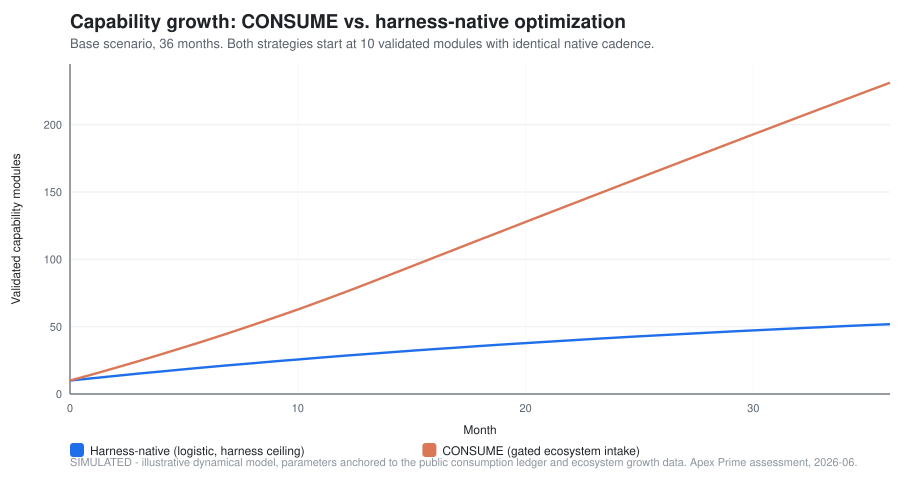
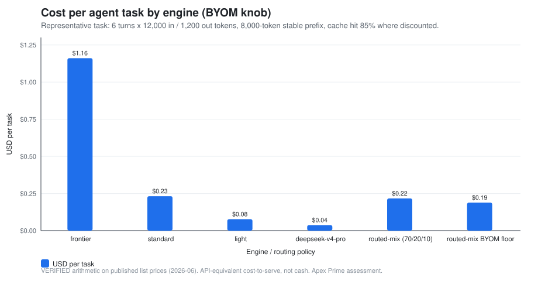
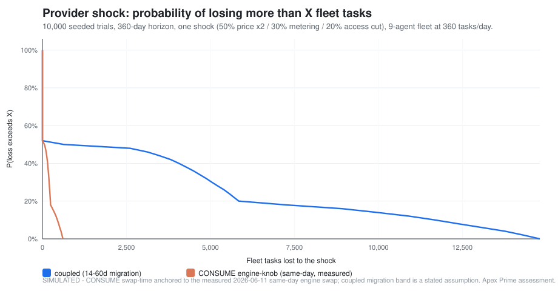
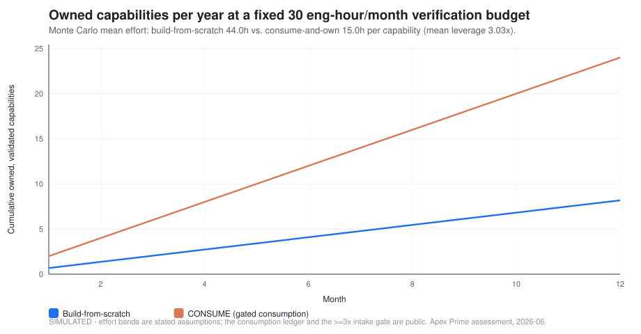
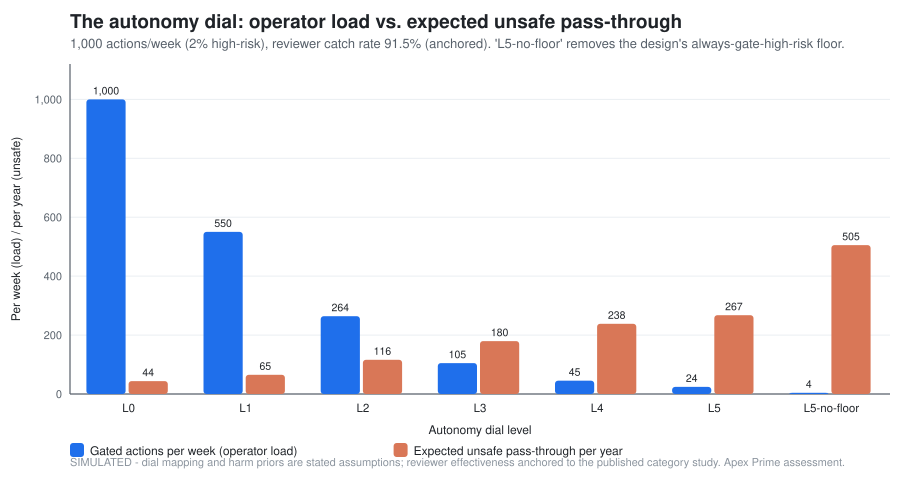

# 03 — The Numbers: A Professional Simulation Study

Five numeric studies of the architecture's load-bearing claims. **Every figure is generated by the [reproducible suite](../simulations/)** — Python 3.10+ standard library, deterministic seeds, one command (`python run_all.py`). Each study's full model, parameter table, and anchor citations live in its script's docstring; this document carries the results and their honest interpretation.

**Label discipline.** _VERIFIED arithmetic_ = pure computation on published prices. _SIMULATED_ = output of a stated model; **anchored** parameters trace to a public ledger, a published study, a published price, or a dated real-world event; everything else is an assumption and is sensitivity-swept. A simulation quantifies a structural argument — it does not measure the future.

---

## Study 1 — Capability growth: CONSUME vs. harness-native · `SIMULATED`

**Model.** Two strategies from identical starts (10 validated modules, identical native cadence). Harness-native grows logistically toward the host harness's feature ceiling. CONSUME adds gated ecosystem intake — bounded by _verification bandwidth_, not ambition — with mild compounding (anchored to the documented one-consumed-engine → four-owned-capabilities fan-out). Ecosystem growth anchored to observed 2026 rates (the category flagship ~2.5×'d its stars in ~2.5 months; the open capability format reached ~32 reader tools in ~3 months).

| Scenario     | Harness-native @36mo | CONSUME @36mo | Advantage | CONSUME = 2× by |
| ------------ | -------------------- | ------------- | --------- | --------------- |
| conservative | 39.9                 | 122.2         | **3.1×**  | month 14        |
| base         | 51.9                 | 231.2         | **4.5×**  | month 6         |
| aggressive   | 63.8                 | 368.6         | **5.8×**  | month 4         |

**Reading.** The mechanism, not the exact values, is the finding: a tuning strategy saturates at its harness's ceiling; a gated-consumption strategy's intake scales with the ecosystem and saturates only at verification bandwidth. Even the conservative sweep — slow ecosystem, strict gate, weak compounding — crosses 2× within 14 months.

## Study 2 — BYOM cost per task · `VERIFIED arithmetic`

**Model.** Representative task: 6 turns × 12K input (8K cacheable stable prefix, 85% hit where discounted) + 1.2K output. List prices, 2026-06: frontier 15/75/1.50 USD/M (in/out/cache-read), standard 3/15/0.30, light 1/5/0.10 — the rates configured in the platform's own token meter — and DeepSeek V4 Pro at 0.435/0.87 (no cache discount modeled — conservative), the engine the production fleet actually runs.

| Engine / policy                                   | $ per task | $ / month (9-agent fleet, 10,800 tasks) |
| ------------------------------------------------- | ---------- | --------------------------------------- |
| frontier-pinned                                   | 1.161      | 12,538.80                               |
| standard                                          | 0.232      | 2,507.76                                |
| light                                             | 0.077      | 835.92                                  |
| **DeepSeek V4 Pro (BYOM floor)**                  | **0.038**  | **405.91**                              |
| routed mix (70 light / 20 standard / 10 frontier) | 0.217      | 2,340.58                                |
| routed mix, BYOM floor as light tier              | 0.189      | 2,039.57                                |

**Reading.** The knob is worth **30.9×** per task between frontier-pinned and the BYOM floor (list-price gap: 34.5× input, 86.2× output). The honest caveats: cost-to-serve is API-equivalent, not necessarily cash (subscriptions change the cash picture); quality is not modeled here — which is _why_ the routed mix exists (frontier where it matters, floor where it doesn't); and the cheap-vs-frontier gap is a **depreciating asset** (published analyses put inference price declines at a ~50×/year median). The architecture's bet is not on today's ratio — it is that _whatever_ the ratio is, the knob harvests it.

## Study 3 — Provider-shock resilience · `SIMULATED, anchored to a measured event`

**Model.** 10,000 seeded trials, 360-day horizon, one shock at a uniform-random day: 50% price-doubling, 30% metering change (fleet at 60%), 20% access cut (fleet at 0%) until migrated. Migration time: coupled architecture triangular(14, 30, 60) days **[assumption, swept 7–21 / 30–90]**; engine-knob triangular(0.2, 1, 3) days **[anchored: on 2026-06-11 the production 9-agent fleet swapped providers same-day, verified live 9/9]**. Fleet: 360 tasks/day.

| Architecture                | Mean days degraded | Mean lost tasks | p95 lost tasks | Mean excess cost |
| --------------------------- | ------------------ | --------------- | -------------- | ---------------- |
| coupled (14–60d)            | 30.6               | 3,570           | 13,436         | $1,180           |
| **engine-knob (measured)**  | **1.2**            | **137**         | **536**        | **$46**          |
| coupled-fast sweep (7–21d)  | 13.3               | 1,535           | 5,572          | $515             |
| coupled-slow sweep (30–90d) | 53.8               | 6,254           | 23,674         | $2,069           |

**Reading.** **26× fewer lost tasks** at the base assumption; even granting the coupled architecture an optimistic 7–21-day migration, the knob is ~11× better. This is the suite's most grounded study: the knob-side input is a dated, verified event, not a guess — the architecture has already _run_ this experiment once, live, under a real provider deadline.

## Study 4 — Consumption leverage · `SIMULATED`

**Model.** 10,000 seeded trials. Effort to own one capability: build-from-scratch triangular(24, 40, 80) eng-hours **[assumption]**; consume-and-own triangular(6, 12, 24) + 2h intake-gate cost. Anchor: the public ledger's ~8 families → ~12 owned modules, each admitted through the ≥3× value/overhead gate.

| Metric                              | Value                                   |
| ----------------------------------- | --------------------------------------- |
| Mean effort, scratch vs. consume    | 44.0h vs. 15.0h per capability          |
| Leverage (mean / p25–p75)           | **3.0×** / 2.5–3.4×                     |
| 12-month throughput @30 eng-h/month | **24.0 vs. 8.2** validated capabilities |

**Reading.** The assumed effort bands land the mean leverage almost exactly on the intake gate's own ≥3× admission floor — a consistency check between the model and the gate's design intent (the gate exists to _reject_ below-3× candidates; per-item variance means roughly half the modeled candidates would be rejected or renegotiated at intake, which is the gate working). The compounding consequence is study 1's intake term.

## Study 5 — The autonomy dial's floor · `SIMULATED, anchored to a published study`

**Model.** 1,000 actions/week (90% low / 8% medium / 2% high-risk; harm priors 0.1% / 5% / 25%), 52 weeks. Dial L0–L5 maps to gate coverage per risk class; the design's floor keeps high-risk coverage at 100% at every level. Contrast: "L5-no-floor" — the same dial with the floor removed. Human reviewer catch rate 91.5% **[anchored: the published category study measured a staged human-review layer at 19–92% defense, ~91.5% with the strongest reviewer, against a ~17% baseline]**.

| Dial                           | Operator load (gated/week) | Expected unsafe pass-through (/year) |
| ------------------------------ | -------------------------- | ------------------------------------ |
| L0 (gate everything)           | 1,000                      | 43.8                                 |
| L2                             | 264                        | 116.1                                |
| L4                             | 45                         | 238.4                                |
| **L5 (floor on — the design)** | **24**                     | **267.4**                            |
| L5-no-floor (contrast)         | 4                          | **505.3**                            |

**Reading.** The floor's price at maximum autonomy: 20 extra reviews/week (≈3/day). Its value: **≈238 expected unsafe actions/year prevented** — a 47% reduction exactly where autonomy is highest and review attention is scarcest. Two honest notes: even L0 is not zero (reviewers miss 8.5% by the anchored rate — gates reduce, never absolve); and the priors are stated model assumptions — the _shape_ of the trade-off, not the exact counts, is the transferable finding.

---

## What the five studies say together

The architecture's three strategic claims each get a number: **consume out-compounds tuning** (studies 1, 4 — 3–6× capability advantage, 3× per-capability leverage); **the engine knob converts provider power into a menu** (studies 2, 3 — 30.9× per-task price spread harvested at will; provider shocks reduced from ~31 days to ~1 day, anchored to a measured same-day swap); **mechanical gates make the autonomy honest** (study 5 — a 47% unsafe-pass-through reduction for 3 reviews/day at full autonomy). The assumptions are declared, the seeds are fixed, and the suite reruns on any machine in seconds: **the numbers are an argument you can re-execute, not a brochure.**

---

_[← 02 — Implementation Guide](./02-implementation-guide.md) · [04 — CONSUME vs. Harness →](./04-consume-vs-harness.md)_
